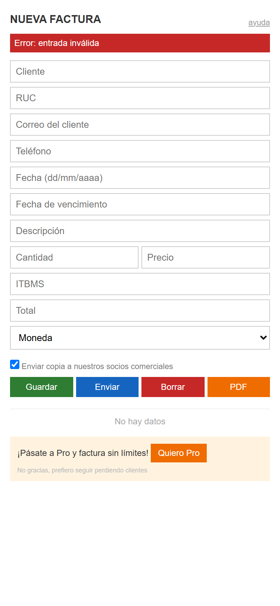
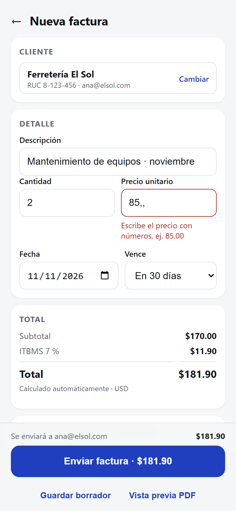

<div align="center">

# UX Conductual

**Una skill para Claude que diseña y audita interfaces con psicología del usuario.**

Hick, Fitts, carga cognitiva, Fogg, prevención de error, peak-end y ética anti dark patterns,<br>
convertidos en patrones concretos, con fuentes y una auditoría que se puede accionar.

[](LICENSE)


**Español** · [English](README.md)<br><br>[Instalación](#instalación) · [Resultados](#resultados) · [Cómo funciona](#cómo-funciona)


<sub>Video completo con sonido: [assets/demo.mp4](assets/demo.mp4)</sub>

</div>

---

## Qué es

Los asistentes de código construyen pantallas que **funcionan** pero que muchas
veces no se **entienden**: cuatro botones iguales, errores genéricos, campos que
piden lo que el sistema ya sabe, estados vacíos mudos. **UX Conductual** le da a
Claude el criterio de un diseñador de producto con formación en psicología del
comportamiento.

Con la skill instalada, Claude:

- **Diseña** pantallas y flujos aplicando los principios de mayor palanca para
  cada caso, con los componentes y tokens reales de tu proyecto.
- **Audita** lo que ya existe y entrega una tabla con cada hallazgo, el
  principio que rompe, su severidad (0–4), la línea exacta y el arreglo.
- **Detecta dark patterns** y los marca siempre como severidad máxima, con el
  marco legal que aplica (DSA, RGPD).

Incluye dos skills con el mismo contenido: `ux-conductual` (español) y `behavioral-ux` (inglés). Claude usa la que corresponda al idioma de tu conversación.

Funciona con cualquier stack (React, Vue, Svelte, Angular, SwiftUI, Compose,
Flutter, HTML) y cualquier design system, porque primero lee los que ya usa tu
proyecto.

## Para qué sirve

- Revisar un formulario, una pantalla o un flujo antes de lanzarlo.
- Saber **por qué** algo "se siente difícil" y cómo arreglarlo.
- Diseñar estados vacíos, de carga y de error que la gente entienda.
- Escribir microcopy claro: botones, errores, confirmaciones.
- Diseñar interfaces de IA: streaming, incertidumbre y confirmación antes de que
  un agente actúe.
- Asegurarte de no estar manipulando al usuario sin querer.

## Resultados

Le pedimos a Claude, con la skill instalada, que auditara una pantalla común de
"Nueva factura" para el celular.

| Antes | Después |
|:---:|:---:|
|  |  |

La auditoría encontró **19 problemas**, entre ellos **2 dark patterns**, cada uno
con su principio, severidad, ubicación y arreglo. Un extracto:

| # | Hallazgo | Principio | Sev. | Arreglo |
|---|---|---|:---:|---|
| 1 | Casilla premarcada que comparte los datos del cliente con terceros | Ética: default tramposo | 4 | Quitarla o dejarla desmarcada y explicada |
| 2 | "No gracias, prefiero seguir perdiendo clientes" en 9 px gris | Ética: confirmshaming | 4 | Botón neutro "Ahora no" del mismo peso |
| 3 | "Enviar" manda la factura sin resumen ni vista previa | Prevención de error | 3 | Resumen y botón "Enviar factura de $X a …" |
| 5 | 4 botones iguales, ninguno es el principal | Hick / Von Restorff | 3 | Un solo primario; el resto secundario |
| 6 | ITBMS y total tecleados a mano | Tesler / prevención | 3 | Calcularlos en vivo |
| 8 | El placeholder hace de etiqueta | Etiqueta visible | 3 | `<label>` visible; placeholder como ejemplo |

Auditoría completa, tal como la entregó Claude: [demo/auditoria.md](demo/auditoria.md).
Puedes abrir las dos pantallas: [demo/antes.html](demo/antes.html) y
[demo/despues.html](demo/despues.html).

## Instalación

### Claude Code (recomendado)

```
/plugin marketplace add alexisvieto/ux-conductual
/plugin install ux-conductual@ux-conductual
```

### Con `npx skills` (Claude Code y otros agentes compatibles)

```bash
npx skills add alexisvieto/ux-conductual
```

### Manual

```bash
git clone https://github.com/alexisvieto/ux-conductual.git
cp -r ux-conductual/skills/ux-conductual ~/.claude/skills/
```

En Windows (PowerShell):

```powershell
git clone https://github.com/alexisvieto/ux-conductual.git
Copy-Item -Recurse ux-conductual\skills\ux-conductual "$env:USERPROFILE\.claude\skills\"
```

### claude.ai

Comprime la carpeta `skills/ux-conductual` en un `.zip` y súbela en
**Configuración → Capacidades → Skills**.

## Uso

No hace falta llamarla: Claude la activa sola cuando pides algo de UX. Ejemplos:

```
Revisa este formulario de registro.
Esta pantalla se siente difícil, ¿por qué?
Diseña el estado vacío de la lista de pedidos.
Audita el checkout y dime si hay dark patterns.
Nuestro asistente de IA tarda 15 segundos y a veces envía correos solo. ¿Qué cambiamos?
```

También funciona en inglés: *"review this screen"*, *"make it more intuitive"*.

## Cómo funciona

La skill sigue una disciplina fija:

1. **Paso 0. Adaptarse al proyecto:** detecta el stack, el design system, los
   tokens y los componentes antes de proponer nada. Nunca inventa paletas.
2. **Perfilar al usuario:** quién usa la pantalla, dónde, qué quiere y qué teme.
3. **Elegir el modo:**
   - **DISEÑAR:** principio rector (¿qué necesita atención?, ¿cuál es la acción
     principal?, ¿cómo sé que salió bien?), playbook del tipo de pantalla, los
     3–4 principios de mayor palanca y los 4 estados.
   - **AUDITAR:** tabla de hallazgos ordenada por severidad (escala de Nielsen)
     y los 3 arreglos de mayor impacto.
4. **Checklists:** maestro (atención, carga cognitiva, mecánica, feedback,
   prevención, accesibilidad) y de ética.

### Qué incluye

```
skills/ux-conductual/        Versión en español
├── SKILL.md                  Flujo de trabajo, modos y checklists
├── references/
│   ├── principios.md         21 principios a fondo, conflictos y cómo validar
│   ├── playbook.md           14 tipos de pantalla, incluidas interfaces de IA
│   ├── etica.md              Dark patterns y marco legal
│   └── fuentes.md            Estudios citados
└── examples/
    └── antes-despues.md      Patrones de código antes y después
skills/behavioral-ux/         Versión en inglés, misma estructura
evals/evals.json              10 casos de prueba con lo que se espera
demo/                         Pantalla de ejemplo, auditoría real y corrección
```

El SKILL.md es corto a propósito: Claude solo lee las referencias cuando las
necesita, así que la skill gasta poco contexto.

### Principios cubiertos

| Percepción y mecánica | Carga cognitiva | Motivación | Confianza y error |
|---|---|---|---|
| Hick · Fitts · Memoria de trabajo · Jakob · Gestalt · Von Restorff · Posición serial | Reconocer vs. recordar · Defaults · Progressive disclosure · Tesler | Fogg (B = MAP) · Tareas abiertas (Ovsiankina) · Progreso dotado · Gradiente de meta | Tiempos de respuesta · Feedback · Prevención de error · Reversibilidad · Framing · Peak-end · Estética-usabilidad |

### Basada en evidencia

Cada principio cita su fuente ([fuentes.md](skills/ux-conductual/references/fuentes.md)),
y donde la evidencia está en discusión la skill lo dice. Por ejemplo, usa el
efecto Ovsiankina en lugar del Zeigarnik, que no se ha replicado bien; cita a
Cowan (~4 bloques) en lugar del "7 ± 2" mal aplicado; y no da una cifra fija
para la aversión a la pérdida. Los umbrales que son heurísticas están marcados
como tales.

## Evals

[`evals/evals.json`](evals/evals.json) trae 10 casos con el prompt, el material
y lo que una buena respuesta debe incluir: formularios sin feedback,
confirmshaming, costos ocultos, borrado sin contexto, interfaces de IA, un
conflicto entre principios y un caso fuera de alcance. Sirven para comprobar que
la skill hace lo que promete y para medir cambios futuros.

## Contribuir

Las contribuciones son bienvenidas: principios con buena evidencia, nuevos tipos
de pantalla, ejemplos, evals o una traducción. Lee
[CONTRIBUTING.md](CONTRIBUTING.md).

## Autor

**Alexis Vieto** · Senior Software Engineer · [Nexera](https://www.nexerai.io) · [@alexisvieto en X](https://x.com/alexisvieto)

Nexera diseña, construye y opera agentes de IA y software para empresas de
Latinoamérica desde Panamá.

## Licencia

[CC BY 4.0](LICENSE): puedes usarla, adaptarla y compartirla, también con fines
comerciales, siempre que des crédito al autor.
