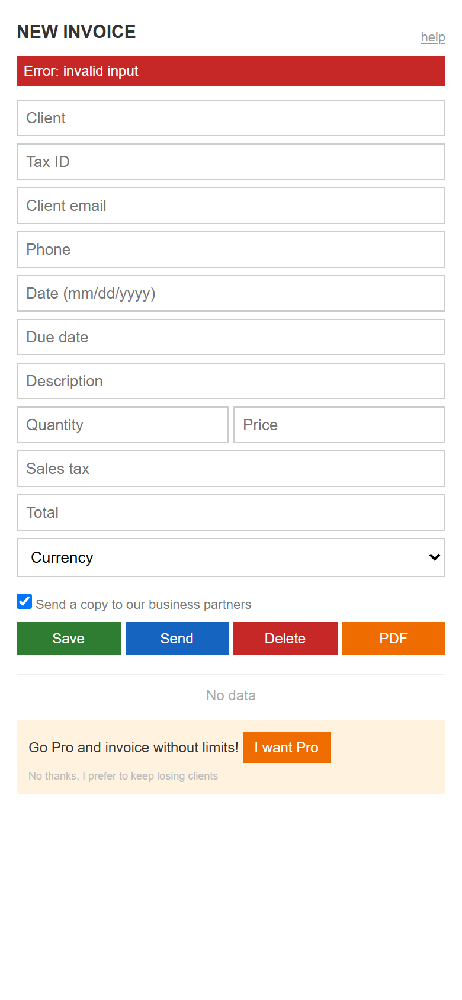
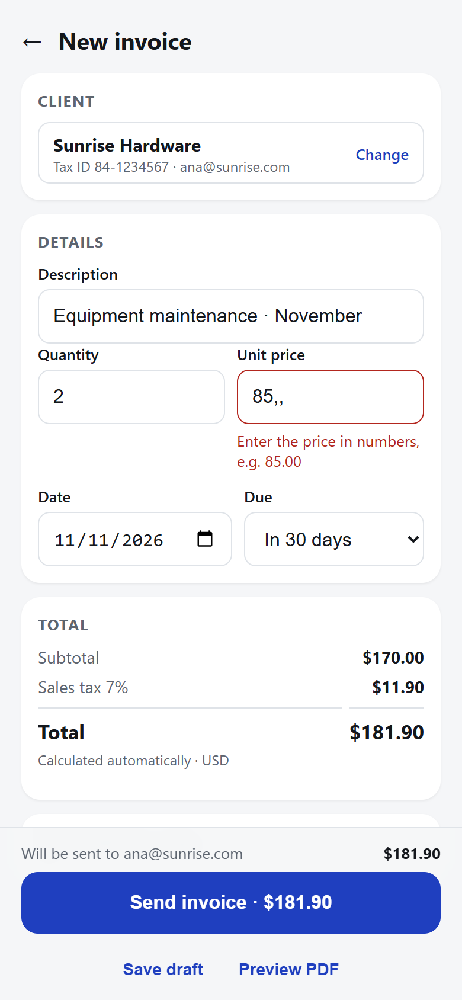

<div align="center">

# Behavioral UX

**A Claude skill that designs and audits user interfaces with behavioral psychology.**

Hick, Fitts, cognitive load, Fogg, error prevention, peak-end and anti dark patterns ethics,<br>
turned into concrete patterns, backed by research, with audits you can act on.

[](LICENSE)


**English** · [Español](README.es.md)

[Install](#install) · [Results](#results) · [How it works](#how-it-works)


<sub>Full video with sound: [assets/demo-en.mp4](assets/demo-en.mp4)</sub>

</div>

---

## What it is

Coding assistants build screens that **work** but often don't **make sense**:
four equal buttons, generic errors, fields asking for what the system already
knows, silent empty states. **Behavioral UX** gives Claude the judgment of a
product designer trained in behavioral psychology.

With the skill installed, Claude:

- **Designs** screens and flows applying the highest-leverage principles for
  each case, with your project's real components and tokens.
- **Audits** what already exists and returns a table with each finding, the
  principle it breaks, its severity (0–4), the exact line and the fix.
- **Detects dark patterns** and always flags them as top severity, with the
  legal framework that applies (DSA, GDPR).

It ships as two skills with the same content: `behavioral-ux` (English) and
`ux-conductual` (Spanish). Claude uses the one that matches your conversation.

It works with any stack (React, Vue, Svelte, Angular, SwiftUI, Compose,
Flutter, plain HTML) and any design system, because it reads the one your
project already uses first.

## What it's for

- Reviewing a form, screen or flow before shipping it.
- Understanding **why** something "feels hard to use" and how to fix it.
- Designing empty, loading and error states people understand.
- Writing clear microcopy: buttons, errors, confirmations.
- Designing AI interfaces: streaming, uncertainty and confirmation before an
  agent acts.
- Making sure you're not manipulating users without meaning to.

## Results

We asked Claude, with the skill installed, to audit a typical mobile
"New invoice" screen.

| Before | After |
|:---:|:---:|
|  |  |

The audit found **19 issues**, including **2 dark patterns**, each with its
principle, severity, location and fix. An excerpt:

| # | Finding | Principle | Sev. | Fix |
|---|---|---|:---:|---|
| 1 | Pre-checked box that shares the client's data with third parties | Ethics: sneaky default | 4 | Remove it, or leave it unchecked and explained |
| 2 | "No thanks, I prefer to keep losing clients" in 9 px gray | Ethics: confirmshaming | 4 | A neutral "Not now" button with equal weight |
| 3 | "Send" fires the invoice with no summary or preview | Error prevention | 3 | Summary plus a "Send $X invoice to …" button |
| 5 | 4 equal buttons, none is the main one | Hick / Von Restorff | 3 | A single primary; the rest secondary |
| 6 | Tax and total typed by hand | Tesler / prevention | 3 | Compute them live |
| 8 | The placeholder acts as the label | Visible label | 3 | Visible `<label>`; placeholder as an example |

Full audit: [demo/en/audit.md](demo/en/audit.md). Open both screens:
[demo/en/before.html](demo/en/before.html) and
[demo/en/after.html](demo/en/after.html).

## Install

### Claude Code (recommended)

```
/plugin marketplace add alexisvieto/ux-conductual
/plugin install ux-conductual@ux-conductual
```

This installs both skills (English and Spanish).

### With `npx skills` (Claude Code and other compatible agents)

```bash
npx skills add alexisvieto/ux-conductual
```

### Manual

```bash
git clone https://github.com/alexisvieto/ux-conductual.git
cp -r ux-conductual/skills/behavioral-ux ~/.claude/skills/
```

On Windows (PowerShell):

```powershell
git clone https://github.com/alexisvieto/ux-conductual.git
Copy-Item -Recurse ux-conductual\skills\behavioral-ux "$env:USERPROFILE\.claude\skills\"
```

For the Spanish version, copy `skills/ux-conductual` instead (or both).

### claude.ai

Zip the `skills/behavioral-ux` folder and upload it under
**Settings → Capabilities → Skills**.

## Usage

You don't need to call it: Claude activates it when you ask for anything UX.
Examples:

```
Review this signup form.
This screen feels hard to use. Why?
Design the empty state for the orders list.
Audit the checkout and tell me if there are dark patterns.
Our AI assistant takes 15 seconds to answer and sometimes sends emails on its own. What should we change?
```

## How it works

The skill follows a fixed discipline:

1. **Step 0. Adapt to the project:** detect the stack, design system, tokens and
   components before proposing anything. It never invents a palette.
2. **Profile the user:** who uses the screen, where, what they want and what
   they fear.
3. **Pick the mode:**
   - **DESIGN:** guiding principle (what needs attention? what's the main
     action? how do I know it worked?), the playbook for the screen type, the
     3–4 highest-leverage principles and the 4 states.
   - **AUDIT:** findings table sorted by severity (Nielsen's scale) and the 3
     highest-impact fixes.
4. **Checklists:** master (attention, cognitive load, mechanics, feedback,
   prevention, accessibility) and ethics.

### What's inside

```
skills/behavioral-ux/         English version
├── SKILL.md                  Workflow, modes and checklists
├── references/
│   ├── principles.md         21 principles in depth, conflicts and how to validate
│   ├── playbook.md           14 screen types, including AI interfaces
│   ├── ethics.md             Dark patterns and legal framework
│   └── sources.md            Studies cited
└── examples/
    └── before-after.md       Before and after code patterns
skills/ux-conductual/         Spanish version, same structure
evals/evals.json              10 test cases with expected behavior
demo/                         Sample screen, real audit and fixed version
```

`SKILL.md` is short on purpose: Claude only reads the references when it needs
them, so the skill uses little context.

### Principles covered

| Perception and mechanics | Cognitive load | Motivation | Trust and error |
|---|---|---|---|
| Hick · Fitts · Working memory · Jakob · Gestalt · Von Restorff · Serial position | Recognition over recall · Defaults · Progressive disclosure · Tesler | Fogg (B = MAP) · Open tasks (Ovsiankina) · Endowed progress · Goal gradient | Response times · Feedback · Error prevention · Reversibility · Framing · Peak-end · Aesthetic-usability |

### Evidence-based

Every principle cites its source ([sources.md](skills/behavioral-ux/references/sources.md)),
and where the evidence is debated the skill says so. For example, it uses the
Ovsiankina effect instead of the Zeigarnik effect, which hasn't replicated well;
it cites Cowan (~4 chunks) instead of the misapplied "7 ± 2"; and it doesn't
give a fixed figure for loss aversion. Thresholds that are heuristics are marked
as such.

## Evals

[`evals/evals.json`](evals/evals.json) contains 10 cases with the prompt, the
material and what a good answer must include: forms without feedback,
confirmshaming, hidden costs, deletion without context, AI interfaces, a
conflict between principles and an out-of-scope case. Use them to check the
skill does what it promises and to measure future changes.

## Contributing

Contributions are welcome: well-evidenced principles, new screen types,
examples, evals or translations. See [CONTRIBUTING.md](CONTRIBUTING.md).

## Author

**Alexis Vieto** · Senior Software Engineer · [Nexera](https://www.nexerai.io)

Nexera designs, builds and runs AI agents and software for companies in Latin
America, from Panama.

## License

[CC BY 4.0](LICENSE): you can use, adapt and share it, including commercially,
as long as you credit the author.
